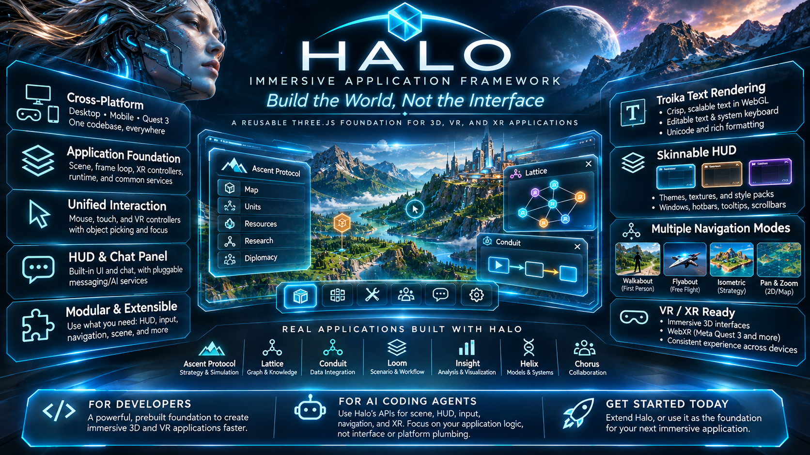

# Halo



Halo is a browser-native Three.js runtime for 3D scenes and WebXR experiences.
It provides the scene rig, navigation, animation loop, selection, XR controllers,
and an in-canvas WebGL HUD for desktop, touch, and immersive applications.

**Apache-2.0. Developers and AI coding agents are welcome to use, modify,
distribute, and contribute.** Third-party components retain their own licenses.

## Try the included example

Install Node.js 24 and npm 11, then:

```sh
git clone https://github.com/Rick-Boardman/vr-halo.git
cd vr-halo
npm ci
npm start
```

Open http://127.0.0.1:8080/examples/chat-panel/. No account, API key, private
repository, neighboring checkout, or cloud deployment is required. WebXR needs
HTTPS outside localhost and a compatible browser/device.

## What it provides

- Scene/HUD bootstrap and canonical render ordering.
- Desktop, touch, flat/isometric, and immersive navigation primitives.
- WebGL HUD windows, text, tooltips, skins, editors, form controls, a graphics and sound
  settings window, and application-fed chat panels.
- World-object selection, XR controllers, frame timing, and cleanup helpers.
- Device input: keys, XR sticks and buttons, VR hands and phone tilt mapped to
  configurable axes and actions, with the motion-permission rules built in.
- Optional system-keyboard integration when the immersive browser reports support.

Applications own their world, game rules, data, network transports, and persistence.
Graph-specific rendering and Mermaid layout belong in Lattice.

## Installation and releases

Download the versioned package and checksum from
[Releases](https://github.com/Rick-Boardman/vr-halo/releases).
See [the quick start](docs/quick-start.md) for exact installation commands,
browser import maps, and a runnable example. Browser-native modules need an
import map; bundlers resolve package imports normally. Keep one Three.js instance.

The package entry point is `@rb/halo`; narrow exports include `/navigation`,
`/tiles`, `/ui`, `/ui/editor`, `/xr`, `/input`, and `/curve-surface`.

## Develop and contribute

```sh
npm run build
npx playwright install chromium
npm run test:browser
npm run audit:release
npm run pack:deliverable
npm run gate
```

`npm run gate` discovers consumers from the committed `origin/main` of repositories
beside the checkout (an `index.html` plus `@rb/halo` in `package.json`). It clones those
exact commits into disposable `.scratchpad/consumer-gate-*` directories, runs `npm ci`
from each committed lockfile, then runs this working copy in place of their pinned
Halo in headless Chromium. Sibling branches, dirty files and installed modules are
never served or changed. The gate prints each consumer commit; its baseline is the
locally recorded `origin/main`, so refresh those remote-tracking refs before release
if needed. Missing lockfiles and failed installs fail the gate; temporary clones are
removed on success or failure. `--only name,name` selects consumers and rejects unknown
names; `--root <directory>` changes the discovery directory.
It fails on page errors, console errors or a Halo file that did not load.
It also serves this checkout's `three` (the exact peer) to each consumer's
`node_modules/three`, since moving the Halo pin moves `three` too; `--own-three` keeps each
consumer's freshly installed locked copy. Run it before tagging a release; see `scripts/consumer-gate.mjs`.
For a breaking peer upgrade, `--overlay <directory>` also tests isolated migrated
consumer files without editing consumer checkouts. It prints file hashes and fails
if an overlay file is not exercised. Keep the unmodified run as evidence too; see
the [repeatable v0.3.0 migration probe](docs/runtime-contracts.md#repeatable-migrated-consumer-gate).

Read [CONTRIBUTING.md](CONTRIBUTING.md) and [AGENTS.md](AGENTS.md).
AI-assisted contributions use the same licensing, testing, and review standards.
Report vulnerabilities privately as described in [SECURITY.md](SECURITY.md).

## Documentation

- [Quick start](docs/quick-start.md)
- [Runtime API](src/README.md)
- [Runtime contracts](docs/runtime-contracts.md)
- [HUD window skinning](HUD-WINDOW-SKINNING.md)
- [Immersive system keyboard and device-testing limits](SYSTEM-KEYBOARD.md)
- [Package delivery](DELIVERY.md)
- [Third-party components and asset provenance](THIRD_PARTY.md)
- [Public release audit](docs/release-audit.md)
- [LICENSE](LICENSE) and [NOTICE](NOTICE)
